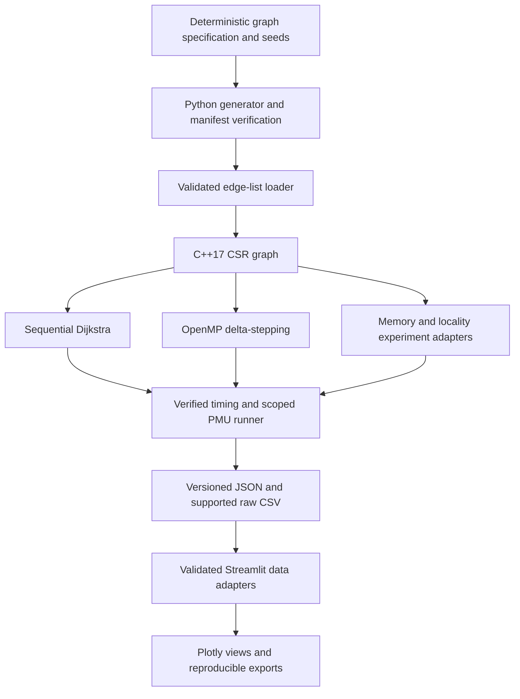
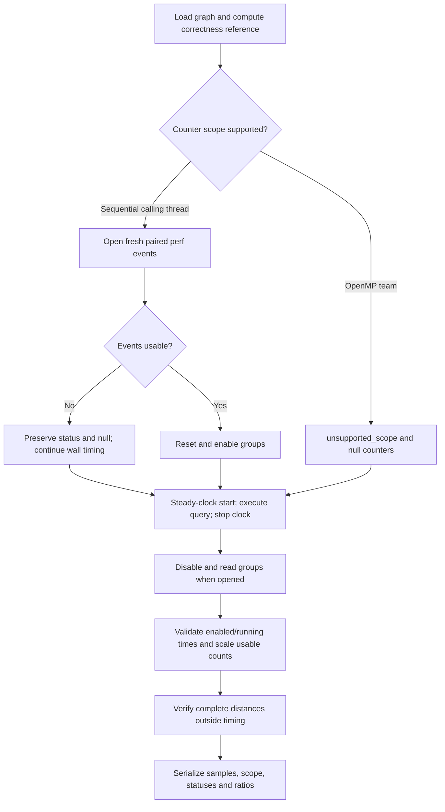
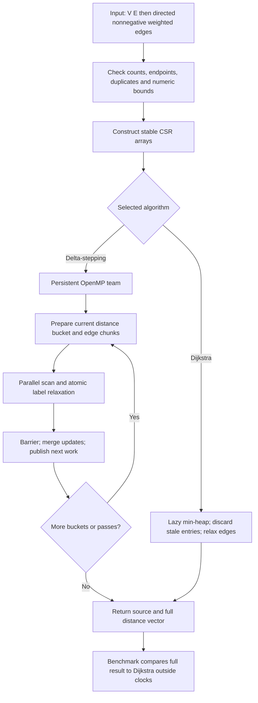
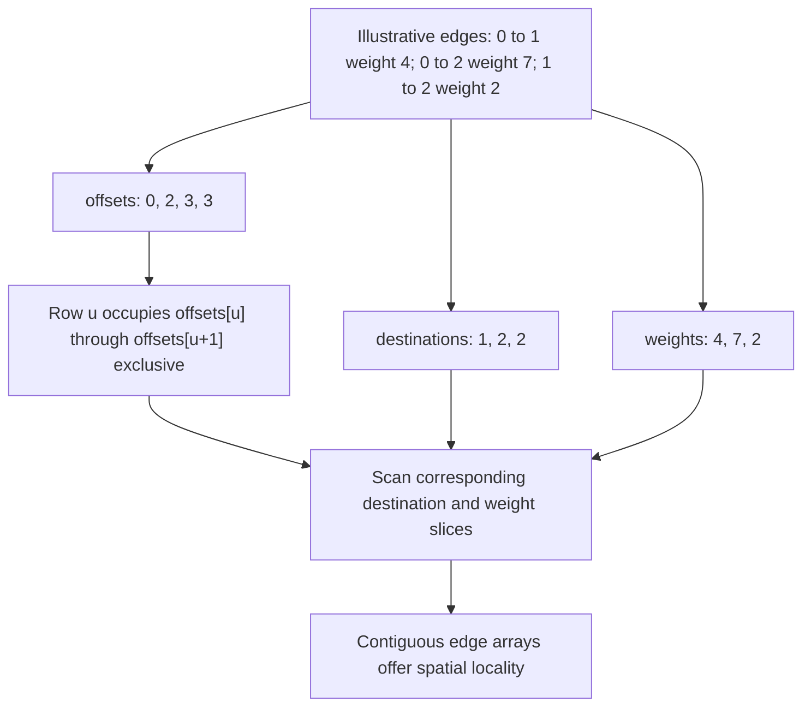
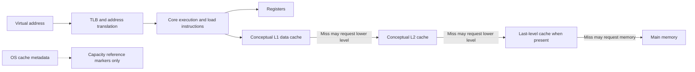
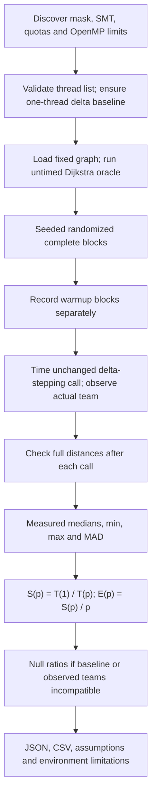
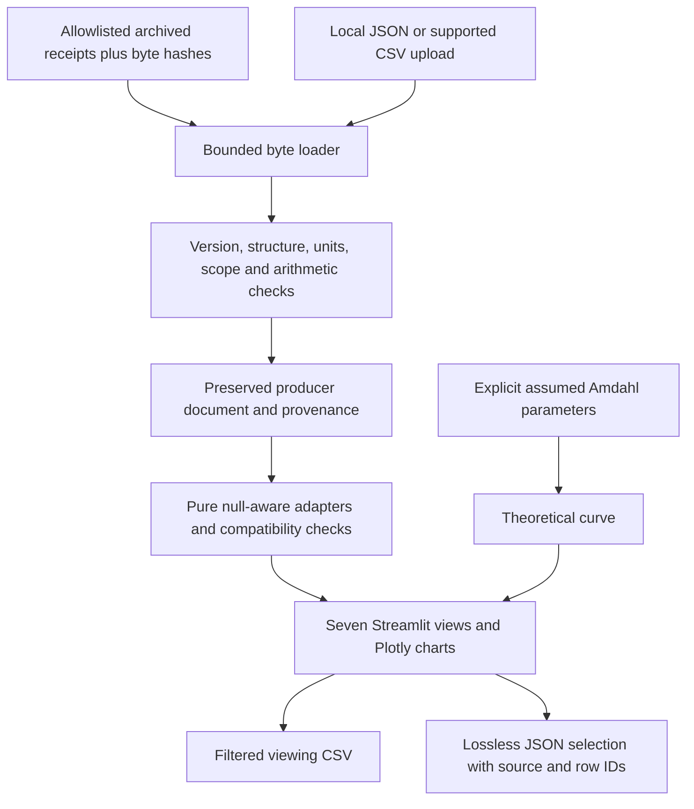

# Architecture diagrams

These diagrams describe the implemented software and conceptual data paths.
They do not claim measured instruction latency, physical cache placement or
exclusive multicore resources. Plain Mermaid flowcharts and quoted labels use
GitHub-compatible fenced syntax; syntax-check results are in FINAL_VALIDATION.md.

## 1. Overall system architecture

The C++ engine produces verified receipts. The dashboard consumes those receipts
without launching benchmarks. Generator manifests preserve deterministic input
provenance; the optional Python UI is not a core build dependency.

## 2. CPU profiling pipeline

Supported PMU collection follows the calling thread with inheritance disabled;
worker aggregation is absent. Multiplexing arithmetic cannot manufacture values
for events that failed. Wall duration and counted CPU activity remain distinct.

## 3. Graph-processing execution flow

The benchmark oracle is the existing Dijkstra implementation; independent
Bellman-Ford test oracles provide additional algorithm validation. Unreachable
distances use the reserved uint64 sentinel internally and JSON null in SSSP output.

## 4. CSR memory representation

This three-vertex example is illustrative representation data, not benchmark
measurements. Logical edge payload uses two uint32 arrays; uint64 offsets require
8(V+1) bytes. Container/capacity and allocator costs are separate accounting terms.
The representation does not guarantee a cache hit or a faster shortest-path query.

## 5. Cache hierarchy and memory flow

The drawing is conceptual, not a topology or inclusion-policy claim for a
particular CPU. Caches move lines; translation uses a separate hierarchy. Prefetch,
sharing, coherence and memory-level parallelism complicate latency attribution.
The receipts lack usable PMU miss measurements, so timing is not labeled L1/L2/L3 hits.

## 6. Multicore scaling experiment workflow

All configurations use the same algorithm and deterministic input. Requested
threads are not assumed to be physical cores. Amdahl curves are separate
predictions for an assumed parallel fraction, not fitted measurements.

## 7. Dashboard data pipeline

Uploads are data rather than paths or executable objects. Diagnostic probe values
never enter workload charts. Real observations, unavailable metrics and theory
retain distinct labels; incompatible documents are not silently pooled.
