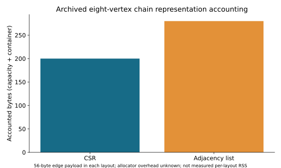
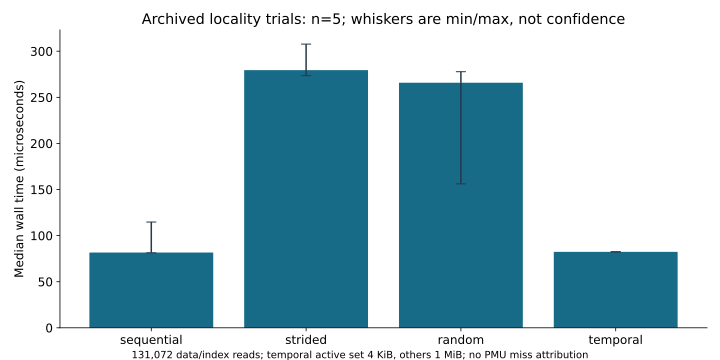
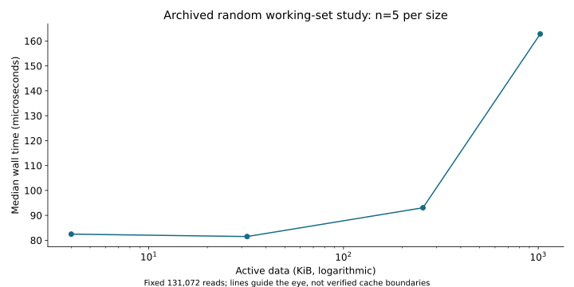
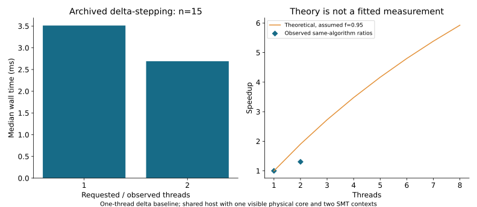

# ArchGraph-COA
## CPU Architecture-Aware Graph Processing and Performance Analysis

### 1. Title page

**Academic level:** fifth-semester Computer Organization and Architecture project.
**Delivery:** Phase 6, 16 November 2026.
**Repository:** [ArchGraph-COA](https://github.com/elementary1645/ArchGraph-COA).
**Submission materials:** [academic index](README.md), [presentation](PRESENTATION.md),
[validation](FINAL_VALIDATION.md).
**Attribution:** selected engine/generator/test code originates in DynaGraph-HPC,
commit `1b5eaea38e4fdfb203ea4214f79f05c8e909c7e9`; see [import record](../IMPORT_PROVENANCE.md).

No student identity, institution, supervisor, approval or signature has been supplied
or invented. This is a technical project report, not an institutional certificate.
Upstream licensing clearance remains unresolved; technical completion is not a
redistribution license or an unrestricted open-source release.

### 2. Abstract

ArchGraph-COA connects graph computation to observable computer-architecture costs.
A validated C++17 engine runs Dijkstra and OpenMP delta-stepping on deterministic
weighted graphs. Additional experiments investigate graph representation, indexed
spatial/temporal locality, scheduling granularity, synchronization and thread
scaling. Linux performance-event instrumentation reports real measurements when
permitted and explicit unavailable states otherwise. A separate Streamlit dashboard
presents versioned results without replacing missing hardware counters with zeros.

The academic analysis rechecks 13 committed receipts and derives tables, figures
and same-algorithm ratios directly from their individual trials. Archived grid
scaling medians are 3.512313 ms at one thread and 2.690738 ms at two threads,
corresponding to a descriptive speedup of 1.3053 and efficiency of 0.6527. The
exposed environment has one physical core and two SMT contexts, so this is not
controlled scaling across independent cores. Hardware counters were denied or
unsupported; neither per-level cache misses nor instruction throughput is inferred
from wall timing. Final verification combines clean builds, existing correctness
suites, sanitizers, receipt audits, dashboard tests and HTTP readiness. The result
is a reproducible teaching system with explicit experimental and licensing limits.

### 3. Introduction

Algorithmic complexity does not determine elapsed time by itself. A shortest-path
query loads indices and weights, branches on tentative distances, allocates working
state and interacts with caches, address translation, operating-system scheduling
and, in parallel execution, synchronization. These operations make graph processing
a useful workload for studying COA, provided observations are not confused with
causal architectural measurements.

The project has six cumulative phases: standalone validated graph processing;
scoped CPU instrumentation; cache/locality and representation experiments;
multicore methodology; an interactive analytics dashboard; and this academic
consolidation. Phase 6 preserves the implemented algorithms and prior evidence.
Its contribution is a verified explanation and delivery package rather than a
new shortest-path algorithm or a claim of peak CPU performance.

### 4. Problem statement

Students need a runnable bridge between CPU/memory concepts and real software
behavior. A simple “parallel is faster” demonstration can be misleading when it
compares different algorithms, hides PMU permission failures, conflates logical
and physical cores, or presents noisy shared-host timing as controlled evidence.
The problem is therefore to provide correct workloads, well-defined measurements,
provenance and explanations that remain useful on restricted commodity systems.

### 5. Objectives

1. Demonstrate CPU instruction execution through meaningful workloads and optional
   retired-instruction/cycle events, without equating source operations with instructions.
2. Explain CSR/adjacency representation, memory accounting and cache opportunities.
3. Investigate indexed spatial and temporal locality with deterministic useful work.
4. Validate sequential/OpenMP results and measure same-algorithm thread scaling.
5. Expose scheduling and synchronization costs using race-free dedicated kernels.
6. Preserve raw trials, machine/build information, scopes and unavailable states.
7. Provide a local dashboard, theoretical Amdahl explorer, reproducible demo and viva materials.

### 6. Background and COA fundamentals

**Instruction execution.** Compilers translate C++ into machine instructions;
loads, arithmetic, branches and atomic operations can have different execution
costs. Pipelining and out-of-order execution allow overlap, while dependencies and
resource contention restrict it. This project does not reconstruct pipeline stages
or measure individual instruction latency. Software edge/relaxation counts are not
retired-instruction counts.

For compatible counted activity, `IPC = instructions / cycles` and
`CPI = cycles / instructions`, provided each denominator is positive. CPU execution
time is often modeled using instruction count, CPI and cycle duration; wall time
also includes descheduling and variable overhead. Variable frequency and unequal
measurement scopes prevent substitution of wall nanoseconds for cycles.

**Memory organization.** Registers, caches, main memory and virtual-address
translation serve different roles. Spatial locality concerns nearby addresses;
temporal locality concerns reuse over time. CSR offers contiguous edge arrays,
but shortest-path label accesses remain graph-dependent. A small footprint is an
opportunity for reuse, not proof of a hit. The [conceptual cache diagram](ARCHITECTURE_DIAGRAMS.md#5-cache-hierarchy-and-memory-flow)
is not a measured topology.

**Execution taxonomy.** The sequential oracle is a SISD teaching example. OpenMP
workers provide MIMD execution: independent instruction streams cooperate on
shared state. A software worker, logical processor and physical core are distinct.
SMT exposes multiple contexts that share core resources. Affinity constrains where
threads may run; quotas constrain CPU-time capacity. Neither implies ownership of
dedicated physical resources.

**Parallel performance.** For fixed algorithm/input/configuration:

$$S(p)=\frac{T(1)}{T(p)},\qquad E(p)=\frac{S(p)}{p}.$$

The theoretical fixed-work model with assumed parallelizable fraction f is:

$$S_A(p)=\frac{1}{(1-f)+f/p},\qquad 0\leq f\leq1.$$

Measured ratios use medians of complete trials, not fitted f. Startup, barriers,
atomics, memory contention and limited graph frontier width can defeat ideal scaling.

### 7. Literature and technical background

Dijkstra's 1959 paper establishes shortest-path reasoning for nonnegative-length
settings; the project uses an imported lazy-heap implementation with modern
storage and independent tests, not a claim that the 1959 implementation used this
C++ representation. [Dijkstra bibliographic record and DOI](https://research.tue.nl/p/en/research-outputs/a-note-on-two-problems-in-connexion-with-graphs).

Meyer and Sanders' delta-stepping research motivates distance buckets and parallel
relaxation. Its theoretical results depend on assumptions and do not establish
runtime bounds for these particular generated inputs or shared hosts. The
[authors' manuscript](https://ae.iti.kit.edu/documents/people/sanders/papers/wmain.pdf)
and [KIT publication discussion](https://ae.iti.kit.edu/english/1294.php) provide
technical background; the implementation's attribution remains the imported source.

Amdahl's original paper discusses limits imposed by nonparallel work. The displayed
formula is the standard idealized fixed-work model, not an empirical characterization
of this program. [Amdahl, original paper](https://www.cs.cmu.edu/~18742/papers/Amdahl1967.pdf).

Drepper's memory report explains memory-system effects and the importance of layout
and access patterns. It motivates questions about reuse, translation and cache lines;
it is not evidence of any miss rate in this project. [Drepper, 2007](https://www.akkadia.org/drepper/cpumemory.pdf).

The implemented compiler reports OpenMP specification date 201511; the
[OpenMP 4.5 specification](https://www.openmp.org/wp-content/uploads/openmp-4.5.pdf)
provides the relevant worksharing, reduction and synchronization model. The project
does not require that this is the newest OpenMP version.

Linux event grouping and enabled/running times are defined by
[perf_event_open](https://man7.org/linux/man-pages/man2/perf_event_open.2.html).
The [kernel security guidance](https://docs.kernel.org/admin-guide/perf-security.html)
explains permission restrictions. The implementation respects those restrictions;
it does not alter perf_event_paranoid or capabilities. Hierarchical CPU-time quotas
are interpreted using the [cgroup v2 documentation](https://docs.kernel.org/admin-guide/cgroup-v2.html).

### 8. System requirements

| Component | Requirement / verification scope |
| --- | --- |
| Core | CMake >=3.21; C++17 compiler; OpenMP and Threads runtime |
| Generator/core tests | Python >=3.8, standard library; independent of dashboard |
| Dashboard | Python >=3.11; isolated Streamlit, Pandas, Plotly, pytest ranges |
| Academic artifacts | Optional python-pptx and Matplotlib; no core dependency |
| Validated OS/compiler | Linux x86_64, GCC 13.3.0; other systems are not certified |
| Hardware profiling | Linux PMU support and existing permissions; optional |
| Demo | Runs with one allowed worker and unavailable counters; two-worker runs require available capacity |

The current delivery environment exposes two logical CPUs in mask `[0,1]`, one
reported physical core/package, SMT and no finite quota at visible cgroup locations.
These are OS-visible observations, not verified physical-host exclusivity.

### 9. System architecture

The [seven architecture diagrams](ARCHITECTURE_DIAGRAMS.md) cover system layers,
profiling, query execution, CSR, conceptual cache flow, scaling and dashboard data
handling. The generator creates a graph plus recipe/seed/hash manifest. The loader
validates input and builds CSR. Engine results are checked before a completed
benchmark receipt is published. Optional profiling is independent of wall-clock
availability. Data adapters validate receipts before the dashboard presents them.

Source modules align with this separation:

| Layer | Representative files |
| --- | --- |
| Graph correctness/storage | `src/graph/`, `src/algorithms/`, independent test oracles |
| CPU/PMU/cache/topology | `src/analysis/`, `src/profiling/perf.cpp` |
| Timing and controlled kernels | `src/benchmark/`, `src/experiments/` |
| Deterministic provenance | `benchmarks/python/`, generator manifests, CSR identities |
| Analytics UI | `dashboard/data/`, `dashboard/charts/`, `dashboard/views.py` |
| Academic delivery | `docs/academic/`, receipt-derived tables/figures and reproduction scripts |

### 10. Methodology

**Fixed inputs and verification.** Generated graphs retain seeds and cryptographic
file hashes. Loaded CSR fingerprints are useful noncryptographic identities, not
replacements for SHA-256 provenance. Dijkstra is the query correctness reference;
retained tests compare algorithms to independent synchronous Bellman-Ford oracles.
Checks compare complete vectors, not only checksums. Dedicated traversal kernels
validate consumed modulo-2^64 checksums.

**Timing boundaries.** All timing uses a monotonic steady clock. Loading, reference
construction and correctness comparisons are outside measured windows. Graph SSSP
calls include call-owned allocation and OpenMP startup. Locality kernels exclude
allocation/setup. Dedicated scheduling kernels exclude team startup and affinity
changes while including worksharing/synchronization. These different boundaries
are documented rather than treated as equal primitive-latency experiments.

**Counter scope.** Sequential Dijkstra can collect calling-thread user-space events
without inheritance. Paired events support same-schedule ratios. Enabled/running
times allow validated multiplex scaling; below the implementation's 10% running
fraction gate values remain unavailable. OpenMP worker aggregation is unsupported,
including one-thread delta-stepping. Diagnostic arithmetic probes are not workload
measurements. No unavailable event is replaced by a numerical zero.

**Repetitions and order.** Phase 2/3 receipts have repeated calls and warmups but
fixed configuration ordering. Phase 4 uses seeded randomized complete blocks;
recorded warmup blocks precede measured blocks. The analysis reports median, minimum,
maximum and unscaled median absolute deviation, not confidence intervals or
statistical significance. Shared-host interference remains possible after randomization.

**Compatibility.** Results from different recorded machines, builds, algorithms or
scopes are not pooled. The dashboard's metadata fingerprints are consistency checks,
not authenticated physical-host identifiers. Standalone CSV lacks provenance and
cannot establish scaling baselines. Original receipt values remain unchanged.

### 11. Implementation

CSR stores uint64 row offsets and uint32 destinations/weights. Outgoing edges for
vertex u occupy `[offsets[u], offsets[u+1])`. For E edges and V vertices, logical
edge payload is `8E` bytes and used offset metadata is `8(V+1)` bytes. Accounted
footprint also includes capacity and container terms; physical allocation and
allocator overhead are not inferred from these formulas.

The sequential algorithm uses a lazy min-heap and skips stale labels. The parallel
engine uses a persistent OpenMP team, light/heavy edge processing, atomic tentative
labels, synchronized bucket preparation and serialized update merging. Phase 4
added a call-owned optional actual-team output without replacing its working loops.
Phase 6 changes neither algorithm.

Array experiments share an indexed scalar kernel across sequential, strided and
random patterns; volatile loads ensure consumption and constrain optimization.
Temporal experiments repeatedly access a configurable prefix. The index stream
has its own storage/read cost. Dedicated kernels compare static/dynamic scheduling,
chunk sizes and reduction versus per-item atomic/critical updates with equivalent
useful transformations and verified checksums. No intentional production data race
is part of the demonstration.

The dashboard has seven views with upload validation, per-event availability,
metadata filters, explicit compatibility checks and deterministic exports. Its
Amdahl model is labeled theoretical; compatible delta-stepping observations may
be overlaid. It does not launch uploaded programs or read paths embedded in JSON.

### 12. Experimental setup

The report's numerical analysis uses the 13 immutable archived catalog receipts,
not new Phase 6 timings substituted into historical results. The integrity audit
checks exact file hashes, supported structures and all Phase 4 CSV/JSON trial pairs.
[RESULTS.json](results/RESULTS.json) retains source paths, hashes, configurations,
CPU/build facts and recomputed summaries. [RESULTS.md](results/RESULTS.md) lists every timing configuration.

| Receipt group | Environment / setup | Measured samples |
| --- | --- | --- |
| Phase 2 bench | Recorded AMD EPYC 9V74 model; GCC Release; tiny fixed graph; PMU denied / OpenMP unsupported | 10 per algorithm; warmups outside recorded samples |
| Phase 5 layout/locality captures of Phase 3 commands | Recorded AMD EPYC 7763 model; Release; fixed-order configurations | 5 per configuration; one configured warmup |
| Phase 4 scaling | EPYC 7763 model; one reported physical core, two SMT contexts; 128x128 bidirectional grid, 16,384 vertices, 65,024 edges; source 0, delta 16 | 15 measured + 2 warmup blocks per thread count |
| Phase 4 scheduling kernels | Same recorded environment; 65,536 irregular elements, chunks 1/64, four strategies, 1/2 threads, seed 42 | 15 measured + 2 warmup blocks per configuration |

Model strings are metadata, not allocation descriptions. Configure-time revisions
and dirty flags are retained; dirty=true does not identify every uncommitted byte.
No dedicated cores, fixed frequency, cold-cache state or PMU fidelity was established.

### 13. Results

#### 13.1 Instrumentation and sequential/OpenMP observations

Phase 2's sequential Dijkstra smoke median is 241 ns (n=10; range 220–761 ns;
MAD 15 ns). Its delta-stepping smoke median is 57,095 ns (n=10; range 56,474–126,999 ns;
MAD 586 ns). These are different algorithms on a tiny workload: the numbers show
that OpenMP overhead can dominate an unsuitable workload, not negative same-algorithm
parallel speedup. No Dijkstra-to-delta ratio is used as thread speedup.

The sequential event states are permission_denied and the OpenMP states
unsupported_scope. IPC, CPI, cycles and cache/branch metrics are unavailable.
Consequently no measured instruction-throughput or per-level miss claim is supported.

#### 13.2 Representation and layout

For the archived eight-vertex, seven-edge chain:

| Quantity | CSR | Adjacency list |
| --- | ---: | ---: |
| Logical edge payload (bytes) | 56 | 56 |
| Used metadata (bytes) | 72 | 192 |
| Capacity storage (bytes) | 128 | 248 |
| Container object (bytes) | 72 | 32 |
| Accounted total (bytes) | 200 | 280 |
| Per-layout physical memory | Unavailable | Unavailable |

Whole-process RSS was 4,620,288 bytes; it includes both layouts and runtime state,
so it is not apportioned between representations. Accounted components overlap;
container overhead estimates must not be added again to accounted totals.

Layout Dijkstra medians were 241 ns CSR and 170 ns adjacency (n=5 each). Fixed
CSR-then-adjacency order, tiny size, allocations and warm state prevent a general
representation-speed claim. Full shortest-path outputs were checked equal. The
historical Phase 3 validation also reports a larger fixed-order grid comparison;
that report is context, while this table uses available committed raw receipts.

#### 13.3 Locality

All four archived patterns allocate 1 MiB and perform 131,072 indexed data reads
with seed 42. Sequential/strided/random use a 1 MiB active set; temporal uses 4 KiB.
The shared scalar kernel controls the index-load mechanism, not every total
instruction or hardware effect.

| Pattern | Active data | Median us | Range us | MAD us | n |
| --- | ---: | ---: | ---: | ---: | ---: |
| Sequential | 1 MiB | 81.673 | 81.312–114.734 | 0.361 | 5 |
| Strided, stride 16 | 1 MiB | 279.482 | 273.471–307.746 | 6.011 | 5 |
| Random indexed | 1 MiB | 265.837 | 156.162–277.829 | 11.992 | 5 |
| Temporal prefix | 4 KiB | 82.354 | 82.344–82.464 | 0.010 | 5 |

These samples associate access patterns/footprints with different elapsed times.
They do not isolate cache misses: configurations ran in fixed order, the index
stream differs, temporal reuse covers fewer distinct data and the host is shared.
Random's broad range demonstrates why a single sample is inadequate.

#### 13.4 Working-set study

| Random active set | Median us | Range us | n |
| --- | ---: | ---: | ---: |
| 4 KiB | 82.464 | 82.374–128.721 | 5 |
| 32 KiB | 81.502 | 81.443–81.522 | 5 |
| 256 KiB | 93.054 | 91.491–122.760 | 5 |
| 1 MiB | 162.814 | 158.707–258.643 | 5 |

Read count stays 131,072. Smaller sets repeat data more often; indices, translation,
prefetch and scheduler effects remain. Capacity markers in the dashboard are
OS metadata, not verified transitions or measured miss rates.

#### 13.5 Thread scaling and Amdahl

| Requested / observed threads | Median ms | Range ms | MAD ms | S(p) | E(p) | n measured |
| --- | ---: | ---: | ---: | ---: | ---: | ---: |
| 1 / 1 | 3.512313 | 3.448333–14.749020 | 0.057297 | 1.0000 | 1.0000 | 15 |
| 2 / 2 | 2.690738 | 2.425492–10.924383 | 0.265246 | 1.3053 | 0.6527 | 15 |

T(1) is one-thread **delta-stepping**. With assumed f=0.95, theoretical S_A(2) is
1.904762. The difference does not estimate a measured serial fraction; costs and
host behavior omitted by the ideal model remain. Two SMT contexts on one reported
physical core cannot establish independent-physical-core scaling.

#### 13.6 Scheduling and synchronization

At two threads and chunk 1, archived irregular-kernel medians were 8.076863 ms
for dynamic reduction, 8.178422 ms for static reduction, 7.994035 ms for static
atomic and 8.308698 ms for static critical (n=15 each). All 272 warmup/measured
calls across configurations checked their outputs. These close, noisy values do
not establish a universal ranking. Work per item is substantial; combined compute,
dispatch and synchronization costs are not an isolated atomic/barrier benchmark.
Chunk 64 and one-thread records are retained in the complete results table.

### 14. Analysis and discussion

The project demonstrates a useful separation between correctness, observations and
architectural interpretation. Correctness tests establish specific software
contracts; they do not prove universal race freedom. Wall-time differences are
real recorded observations; without usable PMU events they cannot identify miss
counts or retired-instruction behavior. Repeated trials expose variability that a
single “fastest run” would hide.

CSR's lower accounted bytes on this tiny graph are explained by storage terms,
while the adjacency timing is lower in those samples. There is no contradiction:
a memory footprint is not a sufficient predictor of query runtime, especially
with fixed order and submicrosecond calls. Similarly, a theoretical Amdahl curve
is a reasoning aid, not a hardware trace or a fitted performance promise.

The delta-stepping same-algorithm baseline is crucial. Comparing Dijkstra and
delta-stepping can be useful as an algorithm choice comparison, but changes useful
work, data structures and overhead. The Phase 4 randomized blocks reduce trial-order
confounding; they do not remove SMT sharing, virtualization or interference.
The dashboard reinforces these distinctions rather than hiding inconvenient nulls.

### 15. Limitations

- Real PMU access was denied; hardware-event collection logic is contract-tested,
  not validated here for physical-counter fidelity. OpenMP aggregation is absent.
- Shared/virtualized resources, SMT, hidden quotas, changing frequencies and
  uncontrolled cache/NUMA state limit causal performance conclusions.
- Phase 2/3 order is fixed; small sample counts, warm state and tiny examples are
  unsuitable for significance or broad performance claims. MAD/range are descriptive.
- Tests and sanitizers are finite evidence; no formal proof, race-detector run,
  cross-platform validation or exhaustive failure coverage is claimed.
- Browser automation/executables are unavailable for this delivery. AppTest,
  HTTP checks and Mermaid parsing are not visual dashboard or PowerPoint rendering.
- Physical topology is OS-reported. Unknown historical fields are not filled from
  the present host. Standalone CSV has insufficient provenance for scaling inference.
- Imported source has no documented license grant. Resolve upstream and project
  licensing before treating this as unrestricted distributable/open-source material.

### 16. Conclusion

ArchGraph-COA is technically ready for a qualified COA demonstration: it connects
instruction metrics, memory layout, locality, concurrency and measurement scope
to reproducible workloads and honest observations. Its strongest result is the
verified, explainable experimental workflow, not a claimed optimal graph engine
or controlled hardware speedup. The final package supports classroom delivery,
oral examination and further measured work while preserving evidence limitations.

### 17. Future scope

First resolve licensing and perform manual browser/PowerPoint/projector review.
Then use an authorized PMU-capable host with dedicated independent cores, documented
frequency/NUMA controls and validated aggregation before expanding hardware claims.
Improve Phase 3 counterbalanced configurations, increase appropriate sample counts,
retain full provenance and use a planned statistical analysis. Portability, race
detection and alternate workloads should be separate validated work, not retroactive
claims about these receipts.

### 18. References

1. Dijkstra, E. W. (1959). *A note on two problems in connexion with graphs*.
   Numerische Mathematik 1, 269–271. [DOI 10.1007/BF01386390](https://doi.org/10.1007/BF01386390);
   [institutional record](https://research.tue.nl/p/en/research-outputs/a-note-on-two-problems-in-connexion-with-graphs).
2. Meyer, U., and Sanders, P. (2003). *Delta-stepping: a parallelizable shortest path
   algorithm*. Journal of Algorithms 49(1), 114–152.
   [DOI 10.1016/S0196-6774(03)00076-2](https://doi.org/10.1016/S0196-6774(03)00076-2);
   [author manuscript](https://ae.iti.kit.edu/documents/people/sanders/papers/wmain.pdf).
3. Amdahl, G. M. (1967). *Validity of the single processor approach to achieving
   large scale computing capabilities*. AFIPS Spring Joint Computer Conference.
   [DOI 10.1145/1465482.1465560](https://doi.org/10.1145/1465482.1465560);
   [original paper copy](https://www.cs.cmu.edu/~18742/papers/Amdahl1967.pdf).
4. Drepper, U. (2007). *What Every Programmer Should Know About Memory*.
   [Author-hosted technical report](https://www.akkadia.org/drepper/cpumemory.pdf).
5. OpenMP Architecture Review Board (2015). *OpenMP API Specification 4.5*.
   [Official specification](https://www.openmp.org/wp-content/uploads/openmp-4.5.pdf).
6. Linux man-pages project. [perf_event_open(2)](https://man7.org/linux/man-pages/man2/perf_event_open.2.html).
7. Linux kernel documentation. [Perf events and tool security](https://docs.kernel.org/admin-guide/perf-security.html);
   [Control Group v2](https://docs.kernel.org/admin-guide/cgroup-v2.html).
8. Streamlit. [AppTest API](https://docs.streamlit.io/develop/api-reference/app-testing/st.testing.v1.apptest).
   Plotly. [Plotly Express](https://plotly.com/python/plotly-express/).
9. DynaGraph-HPC contributors. [Source repository](https://github.com/elementary1645/Dynagraph-HPC),
   pinned import commit above; [local provenance and licensing record](../IMPORT_PROVENANCE.md).
10. ArchGraph-COA. [Phase 1 validation](../VALIDATION.md), [counter methodology](../PERFORMANCE_COUNTERS.md),
    [Phase 3](../PHASE3_VALIDATION.md), [Phase 4](../PHASE4_VALIDATION.md), [Phase 5](../PHASE5_VALIDATION.md),
    [Phase 6 integrity audit](../validation/phase6/evidence-audit.json).

External technical references were checked on 16 November 2026. Publisher DOI
endpoints for Meyer/Sanders and Amdahl restricted automated access; author/original
paper copies and institutional metadata provide accessible support. No text or
figures from these papers are reproduced as original project measurements.

### 19. Appendices

- [Seven explained Mermaid diagrams](ARCHITECTURE_DIAGRAMS.md).
- [Complete derived timing table](results/RESULTS.md) and [machine-readable sources/results](results/RESULTS.json).
- [Reproduction, tools and fresh-output scripts](REPRODUCIBILITY.md).
- [Exact final verification commands and outcomes](FINAL_VALIDATION.md).
- [15-slide presentation and speaker notes](PRESENTATION.md); editable PPTX linked in the index.
- [5–7-minute live demo and archived fallback](LIVE_DEMO.md).
- [Viva questions and answers](VIVA_QA.md).
- [Evidence-based final evaluation](FINAL_EVALUATION.md).
